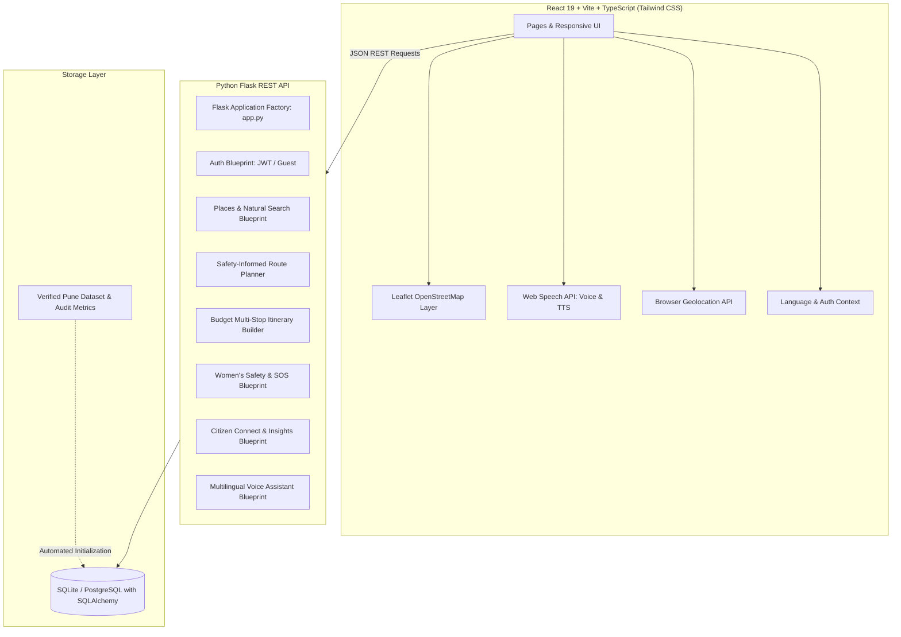

# SafeSteps Pune 🛡️
> **Explore Smarter. Navigate Safer.**  
> A Smart City Exploration and Women’s Safety Platform designed for Pune, Maharashtra.

Built for the hackathon theme:  
*“City Life: Exploring, Experiencing & Navigating the Chaos We Call Home.”*

---

## 📌 Executive Summary

SafeSteps Pune helps Pune residents, women, students, families, and tourists explore the city affordably and safely. It unifies:
- **Interactive OpenStreetMap Leaflet Navigation** with custom categories (History, Budget Food, Cafes, Hotels, Public Facilities, Police, Hospitals, Transit).
- **The SafeSteps Trust Score**: A transparent, weighted 6-factor calculation auditing review confidence, freshness, price reliability, accessibility, community feedback, and safety indicators.
- **Dedicated Women's Safety Centre**: Highest-priority emergency hub with 1-tap call confirmation for **112**, **1091 (Pune Women Helpline / Damini Squad)**, **181**, and **108**, live GPS coordinate copying, trusted contacts management, and a discreet **Quick Exit** button.
- **Multi-Preference Route Planner**: Algorithmic routes comparing **Fastest**, **Safety-Informed** (well-illuminated arterial corridors like JM Road/FC Road, police chowkis, metro hubs), and **Scenic Heritage** routes.
- **Multi-Stop Budget Exploration Planner**: Custom itinerary builder and 5 curated Pune trails under ₹500/₹250/₹800 with stop-by-stop fee and meal breakdowns.
- **Voice & Smart Exploration Assistant**: Web Speech API speech-to-text and speech synthesis in **English**, **हिन्दी (Hindi)**, and **मराठी (Marathi)** with instant emergency keyword escalation.
- **Citizen Connect**: Civic hazard reporting for potholes, dark streetlights, and accessibility obstacles with simulated lifecycle tracking (`Submitted` → `Under Review` → `In Progress` → `Resolved`) and Recharts community analytics.

---

## 🏗️ System Architecture



---

## 🛠️ Technology Stack

| Layer | Technology | Details |
|---|---|---|
| **Frontend** | React 19, TypeScript, Vite | Modern component hierarchy with fast HMR |
| **Styling** | Tailwind CSS v4 | Custom palette: Navy, Royal Blue, Pale Blue, Teal, Emergency Red, Safety Green |
| **Icons** | Lucide React | Clean, responsive SVG UI icons |
| **Maps** | Leaflet with OpenStreetMap | Custom SVG markers, layer management, polyline routes |
| **Routing** | React Router DOM v7 | Client-side routing with clean URLs and breadcrumbs |
| **Charts** | Recharts | Responsive community insights and hazard breakdown |
| **Backend** | Python Flask 3.1 | Modular Blueprint architecture, CORS enabled |
| **Database** | SQLite (default) / PostgreSQL | SQLAlchemy ORM with indexed fields and foreign keys |
| **Authentication**| JWT & Guest Session | Secure token generation with guest fallback |
| **Speech** | Web Speech API | Native browser SpeechRecognition and SpeechSynthesis |
| **Geolocation** | W3C Geolocation API | Browser-based, triggered strictly upon explicit permission |

---

## 🏛️ Real Pune Seed Dataset

The platform is pre-seeded with verified starter places across Pune:

### 1. Historical Attractions
- **Shaniwar Wada** (Shaniwar Peth) — 18th-century Peshwa fortress; ₹25 ticket; ASI verified.
- **Lal Mahal** (Kasba Peth) — Historic red palace of Chhatrapati Shivaji Maharaj; ₹5 entry.
- **Pataleshwar Cave Temple** (Jangali Maharaj Road) — 8th-century monolithic rock-cut cave; Free entry.
- **Mahadji Shinde Chhatri** (Wanawadi) — Anglo-Rajasthani memorial with intricate carvings; ₹20 entry.
- **Mahatma Phule Wada** (Ganj Peth) — Memorial of social reformers Jyotirao & Savitribai Phule; Free entry.

### 2. Budget Dining & Cafes
- **Asha Dining Hall** (Apte Road, Deccan Gymkhana) — Authentic unlimited Maharashtrian thali; ₹200–₹400.
- **Sambar Aromas of South** (Viman Nagar) — Student South Indian breakfast; ₹1–₹200.
- **Chaitanya Parathas** (Fergusson College Road) — Student North Indian staple; ₹200–₹400.
- **Goodluck Cafe** (Goodluck Chowk, FC Road) — Iconic 1935 Irani cafe, bun maska & chai; ₹100–₹250.

### 3. Hotels & Accommodations
- **Hotel Shreyas** (Apte Road, Deccan) — Reputed family hotel with accessible ramp; ₹1,800–₹2,600.
- **Sagar Plaza** (Bund Garden Road, Camp) — Central hotel near Pune Station; ₹2,800–₹4,200.

### 4. Public Facilities & Restrooms
- **PMC Smart E-Toilet & Water ATM** (Deccan Bus Depot) — RO water kiosk & accessible washroom; Free / ₹5.
- **Pune Junction Clean Restrooms & Water Taps** (Station Concourse) — 24/7 hygiene facility; Free / ₹5.

### 5. Hospitals & 24/7 Care
- **Sassoon General Hospital & Trauma Centre** (Station Road, Sangamvadi) — Govt tertiary trauma care.
- **Sahyadri Super Speciality Hospital** (Karve Road, Deccan) — 24/7 critical care & pharmacy.

### 6. Police Stations & Safety Cells
- **Faraskhana Police Station & Women Cell** (Budhwar Peth, near Shaniwar Wada) — Damini Squad base.
- **Deccan Gymkhana Police Station** (Prabhat Road / FC Road) — 24/7 student & tourist beat.

### 7. Public Transport Hubs
- **Shivajinagar Metro & Suburban Station** — Purple Line hub with tactile paving & elevators.
- **Swargate Intercity Bus & Metro Terminal** — Major transit junction connecting PMPML & MSRTC.

---

## ⚖️ The SafeSteps Trust Score Formula

The **SafeSteps Trust Score** is a transparent, weighted formula (0–100) calculated dynamically:

$$\text{Trust Score} = 0.20(\text{Review Confidence}) + 0.20(\text{Info Freshness}) + 0.15(\text{Price Reliability}) + 0.15(\text{Accessibility Coverage}) + 0.15(\text{Community Feedback}) + 0.15(\text{Safety Coverage})$$

- **Review Confidence (20%)**: Sourced review sample size and recency.
- **Information Freshness (20%)**: Verified status as of October 2026.
- **Price Reliability (15%)**: Predictability and transparency of listed costs.
- **Accessibility Coverage (15%)**: Documented ramps, accessible restrooms, and level pathways.
- **Community Feedback (15%)**: Resident upvotes and lack of unresolved safety complaints.
- **Safety Coverage (15%)**: Documented illumination, CCTV, and police beat proximity.

> **Transparent Safety Principle:** A high trust score certifies data reliability and customer satisfaction; it does **not** imply a government safety guarantee. Safety information is audited as an independent factor.

---

## 🚦 Live Integrations vs. Simulated Features Disclosure

In compliance with ethical hackathon and safety guidelines:

| Feature | Status | Details |
|---|---|---|
| **OpenStreetMap & Leaflet** | **Live Integration** | Real tile rendering, zoom, and interactive coordinates. |
| **Web Speech API Voice & TTS** | **Live Integration** | Speech recognition and speech synthesis in English, Hindi, and Marathi. |
| **Browser Geolocation API** | **Live Integration** | Fetches exact device GPS coordinates only upon user tap. |
| **Emergency Tel Links (112, 1091)**| **Live Integration** | Direct RFC 3966 `tel:` links opening device dialer with confirmation. |
| **SOS Broadcast** | **Simulated Integration** | Generates verified coordinate URLs and SMS text. Does not claim automated police computer dispatch. |
| **PMC Municipal Escalation** | **Simulated Integration** | Demo status progression workflow; does not submit tickets to PMC Care API. |

---

## 🚀 Quickstart & Installation Instructions

### Prerequisites
- **Python 3.10+** (Python 3.14 verified)
- **Node.js 20 LTS+** and **npm**

### 1. Clone or Open Workspace
Navigate to the project root:
```powershell
cd "C:\Users\Parth Labhshetwar\.gemini\antigravity\scratch\safesteps-pune"
```

### 2. Backend Setup
```powershell
cd backend
python -m pip install -r requirements.txt
python seed.py
python test_api.py   # Verify all 9 backend test suites pass
```

### 3. Frontend Setup
```powershell
cd ../frontend
npm install
npm run build        # Verifies production TypeScript compilation
```

### 4. Run the Full Application Locally
You can start both frontend and backend using the included startup scripts:

**Using PowerShell:**
```powershell
.\run_local.ps1
```

**Using Command Prompt:**
```cmd
run_local.bat
```

**Or manually in two terminals:**
- **Terminal 1 (Backend):**
  ```powershell
  cd backend
  python app.py
  # Running at http://localhost:5000
  ```
- **Terminal 2 (Frontend):**
  ```powershell
  cd frontend
  npm run dev
  # Running at http://localhost:5173
  ```

Open your browser to: **`http://localhost:5173`**

---

## 📡 API Documentation

| Method | Endpoint | Description |
|---|---|---|
| `GET` | `/api/health` | Health check endpoint returning city and version |
| `GET` | `/api/categories` | Returns category metadata with place counts |
| `GET` | `/api/places` | Lists places with category, budget, and accessibility filters |
| `GET` | `/api/places/:id` | Returns place details with reviews and trust score breakdown |
| `GET` | `/api/search?q=...` | Natural language search with intent parser |
| `POST` | `/api/routes` | Computes Fastest, Safety-Informed, or Scenic routes with waypoints |
| `GET` | `/api/itinerary` | Returns 5 sample Pune itineraries |
| `POST` | `/api/itinerary` | Custom multi-stop budget itinerary generator |
| `GET` | `/api/safety-contacts` | Lists official helpline numbers (112, 1091, 181, 108) |
| `POST` | `/api/sos-trigger` | Formats emergency SMS coordinates and contacts |
| `GET` | `/api/trusted-contacts`| Lists user's configured trusted contacts |
| `POST` | `/api/trusted-contacts`| Adds family/friend trusted contact |
| `GET` | `/api/reports` | Lists civic reports with category & status filters |
| `POST` | `/api/reports` | Registers a new civic hazard report |
| `PATCH`| `/api/reports/:id/status`| Updates status (Submitted → Under Review → In Progress → Resolved) |
| `GET` | `/api/insights` | Aggregates civic reporting analytics for Recharts |
| `POST` | `/api/assistant/chat` | Multilingual exploration chatbot with emergency trigger |

---

## 📄 License & Attribution

- Built for the Pune Smart City & Women's Safety Hackathon.
- OpenStreetMap data &copy; [OpenStreetMap contributors](https://www.openstreetmap.org/copyright).
- Archeological Survey of India (ASI) & Pune Municipal Corporation public monuments reference.
